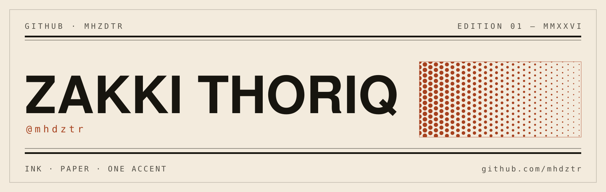
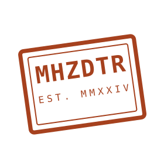

  <picture>
    <source media="(prefers-color-scheme: dark)" srcset="assets/masthead-dark.svg">
    
  </picture>

> Software in Rust, Java, and JavaScript. Some of it replaces a paid tool. Some of it keeps a fisheries directorate running. Some of it just plays music.

**[LinkedIn](https://linkedin.com/in/zakkithoriq)** &nbsp;·&nbsp; **[zakkithoriq@gmail.com](mailto:zakkithoriq@gmail.com)**

## Selected work

### 01 · [smelt](https://github.com/mhdztr/smelt)

Melt any document into any other. One self-contained binary instead of a pandoc invocation or a LibreOffice-per-file wrapper — documents are read into one normalized model, so a new format costs one reader or one writer instead of an N×M matrix of converters. ~5 ms startup, warm engine pools, page-parallel PDF.

RUST · MIT · CLI

### 02 · [Nakhoda](https://github.com/mhdztr/Nakhoda)

The single source of truth for crew management at Dit. POA — the Directorate of Fleet Monitoring and Operations, Ministry of Marine Affairs and Fisheries. Runs as a self-contained satellite on Google Apps Script with an isolated Sheets database, which is how it stays fast at operational volume without lock contention.

JAVASCRIPT · GOOGLE APPS SCRIPT · KKP RI

### 03 · [sweep](https://github.com/mhdztr/sweep)

A storage cleaner for Arch that makes you type `PURGE` — per category, on purpose — before it deletes anything. Pre-alpha and honest about it: `scan` is read-only, eleven safe rules are live, the destructive tier is still milestone work.

RUST · PRE-ALPHA · LINUX

### 04 · [sonora-player](https://github.com/mhdztr/sonora-player)

A desktop music player in Java 17: gapless playback, queue management, fingerprinting for tracks whose metadata can't identify them, content-based recommendations, and a live visualizer. VLCJ underneath, FlatLaf on top.

JAVA 17 · VLCJ · DESKTOP

## Also public

- **[nautika](https://github.com/mhdztr/nautika)** — monitoring and reporting dashboard for the same directorate.
- **[SIKAP](https://github.com/mhdztr/SIKAP)** — finance, budget, and personnel system for its administrative sub-division.
- **[darikita](https://github.com/mhdztr/darikita)** — donation platform.
- **[upnext-backend](https://github.com/mhdztr/upnext-backend)** — scheduling API, deployed at [upnext-be.vercel.app](https://upnext-be.vercel.app).

SIAGA · SISTIK · Radar-POA · awamaman · Final-Project · and the 2024 course work are live but not interesting yet.

## Stack

Rust for anything that ships as one binary. Java when there's a window and a playlist. JavaScript when the runtime belongs to a browser, or to Google. HTML when someone wants a dashboard.

&nbsp;&nbsp;&nbsp;

## Colophon

Ink `#17150F` on paper `#F3EBDD`, one accent: rust `#A6411E`. The masthead, rules and postmark are hand-drawn SVG in `assets/`; the badges are shields.io reading live from GitHub. No emoji. No typing animation. No trophy case.

&nbsp;&nbsp;

<picture>
  <source media="(prefers-color-scheme: dark)" srcset="assets/stamp-dark.svg">
  
</picture>

— ZT · MMXXVI

