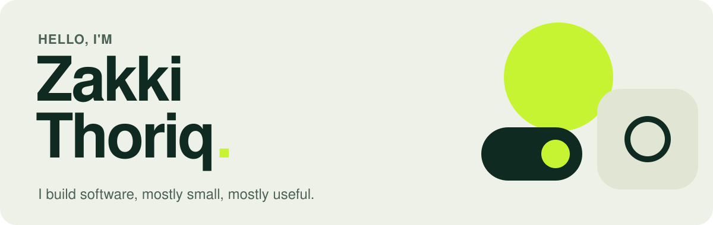
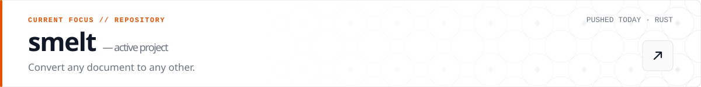
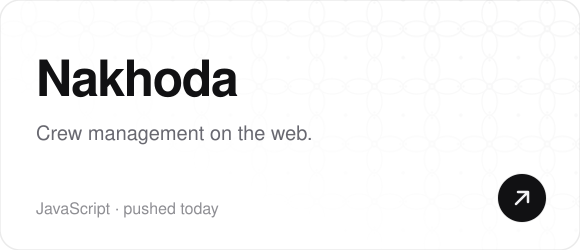
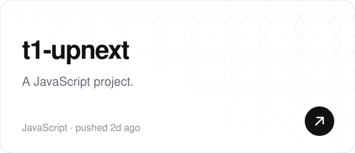
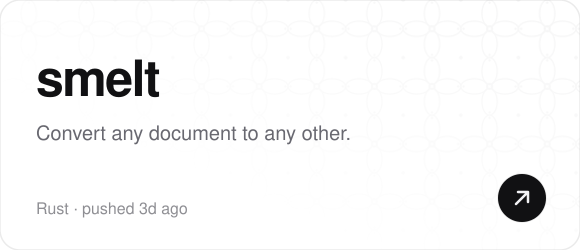
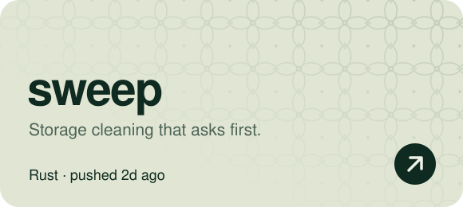
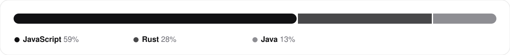
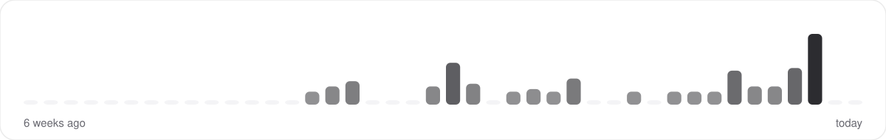

<!-- Generated by scripts/build.mjs from this template. Edit here, not in README.md. -->

<picture><source media="(prefers-color-scheme: dark)" srcset="assets/hero-dark.svg"></picture>

I like tools that do one thing well such as command-line utilities, desktop apps, and the occasional system that helps a team get its work done. Always doing stuff I guess (occasionally).

**[LinkedIn](https://linkedin.com/in/zakkithoriq)** &nbsp;·&nbsp; **[Email](mailto:zakkithoriq@gmail.com)** &nbsp;·&nbsp; **[GitHub](https://github.com/mhdztr)**

<a href="https://github.com/mhdztr/smelt"><picture><source media="(prefers-color-scheme: dark)" srcset="assets/now-dark.svg"></picture></a>

## Recently shipped

<table>
<tr>
<td><a href="https://github.com/mhdztr/smelt"><picture><source media="(prefers-color-scheme: dark)" srcset="assets/tile-1-dark.svg"></picture></a></td>
<td><a href="https://github.com/mhdztr/Nakhoda"><picture><source media="(prefers-color-scheme: dark)" srcset="assets/tile-2-dark.svg"></picture></a></td>
</tr>
<tr>
<td><a href="https://github.com/mhdztr/SIKAP"><picture><source media="(prefers-color-scheme: dark)" srcset="assets/tile-3-dark.svg"></picture></a></td>
<td><a href="https://github.com/mhdztr/sweep"><picture><source media="(prefers-color-scheme: dark)" srcset="assets/tile-4-dark.svg"></picture></a></td>
</tr>
</table>

## How I spend my time

<picture><source media="(prefers-color-scheme: dark)" srcset="assets/lang-dark.svg"></picture>

<picture><source media="(prefers-color-scheme: dark)" srcset="assets/activity-dark.svg"></picture>

Active on 19 of the last 6 weeks. Everything above rebuilds itself from the GitHub API every 12 hours.
